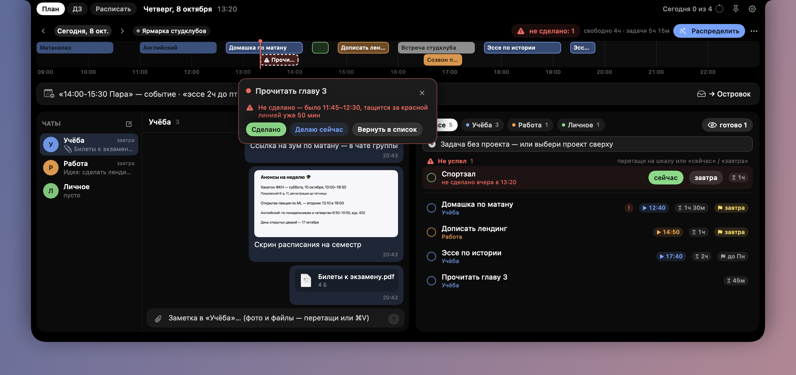
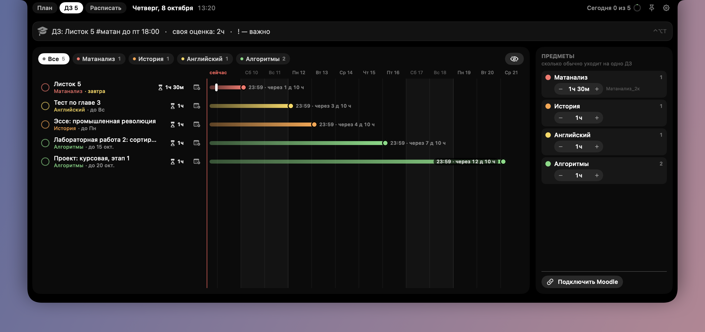
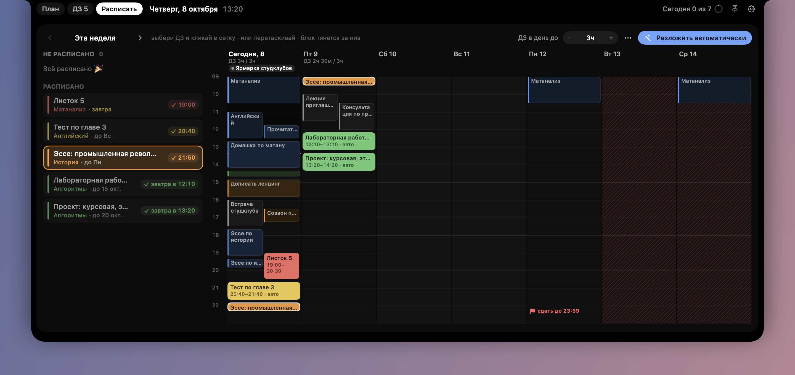

# Островок

**Расписание, задачи, домашки и заметки — в «динамическом островке» у выреза MacBook.**

*A Dynamic-Island-style planner for the MacBook notch: day timeline, tasks, homework deadlines from Moodle, chat-like notes, events from screenshots via DeepSeek. UI is in Russian.*



<p>
  
  
</p>

## Что умеет

- **Островок у выреза.** Свёрнутый показывает текущее/следующее дело и прогресс дня; по клику (или ⌃⌥T из любого приложения) раскрывается на верх экрана.
- **Шкала дня.** Задачи перетаскиваются из списка прямо на шкалу, блоки двигаются и растягиваются. Клик по блоку — подробности (место, заметки, ссылка, календарь).
- **«Камни».** Не сделал задачу вовремя — блок цепляется к красной линии «сейчас» и тащится за ней, а в конце дня возвращается в список «Не успел».
- **Строка «мероприятие или задача».** Пиши как удобно — «в сб в 19:00 ужин с Катей», «написать эссе завтра 2ч» — DeepSeek разберёт: мероприятие уйдёт в календарь, задача встанет в расписание.
- **Скриншоты → мероприятия.** Перетащи скриншот афиши/расписания к вырезу — текст распознаётся на Mac, DeepSeek находит мероприятия, они добавляются в календарь.
- **Домашки из Moodle.** Дедлайны подтягиваются из календаря LMS и показываются линиями «сейчас → дедлайн». У каждого предмета своя оценка времени на ДЗ.
- **«Расписать»** — неделя сеткой: раскладка ДЗ кликами, перетаскиванием или автоматически до дедлайнов с лимитом часов в день.
- **«Распределить»** — раскидать задачи по свободным окнам дня, сначала срочные.
- **Чаты-заметки.** Каждый проект — чат для себя: текст, фото, файлы.
- **Календарь macOS** (iCloud, Google, Яндекс по CalDAV и т. д.): события видны в расписании, новые пишутся в выбранный календарь.



## Установка

Нужно: **macOS 14 Sonoma или новее**. Лучше всего — MacBook с вырезом (без выреза островок просто встанет по центру сверху).

### Вариант 1 — собрать из исходников (рекомендуется)

Понадобятся только Command Line Tools (полный Xcode не нужен):

```bash
xcode-select --install
```

```bash
git clone https://github.com/Egor-cruutoo/notch-planner.git
```

```bash
cd notch-planner && ./build.sh install
```

Скрипт соберёт приложение под твой Mac, положит его в `/Applications/Островок.app` и запустит.

### Вариант 2 — готовая сборка

Скачай `Ostrovok.zip` со страницы [Releases](https://github.com/Egor-cruutoo/notch-planner/releases), распакуй и перетащи «Островок» в «Программы».

Сборка не подписана сертификатом разработчика Apple, поэтому при первом запуске macOS её заблокирует. Открой так: правый клик по приложению → «Открыть» → «Открыть». Если на новых версиях macOS кнопки нет — Системные настройки → Конфиденциальность и безопасность → «Всё равно открыть». Или одной командой:

```bash
xattr -dr com.apple.quarantine /Applications/Островок.app
```

## Первый запуск

- Иконки в Dock нет — приложение живёт у выреза и в строке меню.
- **Открыть островок:** клик по чёрной полоске у выреза или **⌃⌥T**. **Свернуть:** Esc или клик мимо.
- Шестерёнка справа вверху — настройки: время дня, перерывы, открытие по клику/наведению, **«Запускать при входе»**.

### DeepSeek (для строки мероприятий и скриншотов)

1. Получи свой ключ на [platform.deepseek.com](https://platform.deepseek.com) (API платный, но копеечный).
2. Островок → шестерёнка → карточка «Островок» → поле «Ключ DeepSeek» → «Сохранить».

Ключ хранится в **Связке ключей macOS**, не в файлах. Без ключа строка понимает только явное время («14:00-15:30 Пара»), а задачи ставит в ближайшее окно.

### Moodle (домашки)

В LMS: «Календарь» → «Импорт или экспорт календарей» → «Экспортировать календарь» → «Все курсы» + «Недавние и следующие 60 дней» → «Получить URL календаря». Ссылку вставь в Островок: вкладка «ДЗ» → «Подключить Moodle».

### Календарь (в т. ч. Яндекс)

Островок работает через Календарь macOS. Для Яндекса: в Яндекс ID создай пароль приложения для «Календаря», затем Системные настройки → Учётные записи интернета → Добавить → учётная запись CalDAV, «Вручную», сервер `caldav.yandex.ru`. Потом в Островке: шестерёнка → «Календарь» → «Связать с Календарём» и выбери, куда записывать.

## Приватность и безопасность

- **Всё хранится локально:** данные — `~/Library/Application Support/Ostrovok/data.json`, вложения чатов — рядом в `attachments/`. Никаких серверов у приложения нет.
- **Ключ DeepSeek** — только в Связке ключей macOS. В репозитории и в файле данных ключей нет.
- **Что уходит в сеть:**
  - в DeepSeek — только текст, который ты написал в строке, или текст, распознанный со скриншота (сама картинка не отправляется — распознавание идёт на Mac через Apple Vision);
  - в твою LMS — запрос твоей же ссылки экспорта календаря;
  - синхронизацию календарей делает сама macOS.
- Ссылка экспорта Moodle содержит личный ключ доступа к твоему календарю — не публикуй её.
- Доступ к Календарю запрашивается только когда ты сам включаешь «Связать с Календарём». Островок меняет в календаре только события, которые создал сам.

## Синтаксис строк (если без DeepSeek)

| Пишешь | Получаешь |
|---|---|
| `Домашка по матану 1.5ч до пт !` | задача, 1,5 часа, срок — пятница, важная |
| `14:00-15:30 Пара по физике` | событие сегодня |
| `завтра в 10:00 созвон 30м` | событие завтра 10:00–10:30 |
| `по пн ср 9:00-10:30 Матан` | повторяется каждую неделю |
| `Листок 5 #матан до пт 18:00` | (на вкладке «ДЗ») домашка по предмету «матан» |

## Разработка

```bash
./build.sh            # собрать build/Островок.app под этот Mac
./build.sh run        # собрать и запустить
./build.sh test       # самопроверка: разбор строк, планировщик, Moodle, импорт, «камни», чаты
./build.sh release    # универсальная сборка (Apple Silicon + Intel) → build/Ostrovok.zip
```

Чистый Swift + SwiftUI/AppKit, без зависимостей и Xcode-проекта. Код — в `Sources/`:
`IslandController` (окно у выреза), `MainTimeline` (шкала дня, «камни»), `Store` (данные, планировщик), `QuickParser` (разбор строк), `Homework*` (Moodle, ДЗ, недельная сетка), `ScreenshotImport` (Vision + DeepSeek), `Chats`, `CalendarService` (EventKit).

## Удаление

Выйти из Островка (шестерёнка → «Выйти»), затем:

```bash
rm -rf /Applications/Островок.app ~/Library/Application\ Support/Ostrovok
```

Ключ DeepSeek удаляется в настройках («Удалить») или в приложении «Связка ключей» (запись «Островок — ключ DeepSeek»).

## Лицензия

[MIT](LICENSE)
